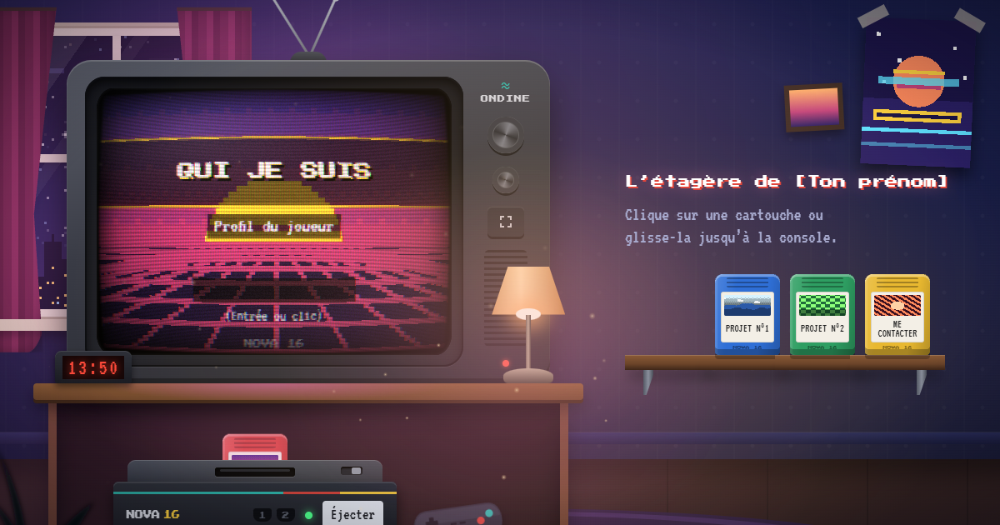

# L’étagère de Denis

Un portfolio à jouer. Une chambre d’ado des années 90, la nuit : une télé cathodique **ONDINE**
posée sur un meuble, une console 16 bits **NOVA 16** rangée dessous, et une étagère de cartouches.
Clique sur une cartouche (ou glisse-la) : elle vole jusqu’à la console, s’enfonce dans la fente,
la télé s’allume et affiche la page liée à la cartouche.



## Lancer le projet

Il faut [Node.js](https://nodejs.org) 20 ou plus récent.

```bash
npm install
npm run dev
```

Le site s’ouvre sur <http://localhost:5173>.

```bash
npm run build     # génère la version de production dans dist/
npm run preview   # sert dist/ en local pour vérifier
```

## Modifier les cartouches

Tout le contenu est dans **un seul fichier** : [`src/data/carts.js`](src/data/carts.js).
Chaque objet du tableau `CARTS` est une cartouche de l’étagère. Tu n’as rien d’autre à toucher.

```js
{
  id: "projet-3",                 // lien direct : /#projet-3
  title: "Projet n°3",            // étiquette + écran titre
  subtitle: "Mon super jeu",      // ligne sous le titre
  color: "#8e44ad",               // couleur du plastique
  motif: "galaxie",               // décor : coucher, montagnes, damier, rayures, galaxie, vagues
  palette: { bg: "#1b0f2e", fg: "#f3eaff", accent: "#c08cff", art: ["#1b0f2e", "#6b3fa0", "#ffd23f"] },
  music: { root: 62, tempo: 120 }, // facultatif : note de base (MIDI) et tempo de la musique
  blocks: [
    { type: "title", text: "Mon super jeu" },
    { type: "text", text: "Ce que j’ai fait, pourquoi, comment." },
    { type: "image", src: "/images/capture.png", alt: "Capture du jeu" },
    { type: "tags", items: ["Godot", "Pixel art"] },
    { type: "link", label: "Jouer", href: "https://exemple.fr" },
  ],
},
```

Types de blocs disponibles : `title`, `heading`, `text`, `hero` (avatar + texte), `stats`,
`bars` (jauges de 0 à 1), `tags`, `list` (liste à puces), `image`, `link`, `links`, `countdown`. La liste complète, avec un
exemple pour chacun, est en tête de `src/data/carts.js`.

- Ajouter une cartouche : copie un objet du tableau, change son `id`. Elle apparaît sur l’étagère.
- Retirer une cartouche : supprime son objet.
- Changer l’ordre : déplace les objets dans le tableau (les touches 1 à 9 suivent cet ordre).
- Images : dépose-les dans `public/images/` et utilise `src: "/images/mon-image.png"`.
- Prénom affiché : `OWNER` (bas de `carts.js`) pour l’enseigne et l’intro, et `index.html`
  pour le titre de l’onglet et les balises de partage.

Les textes entre crochets (`[ton outil préféré]`…) sont à remplacer par les tiens.

## Redéployer

Le site est hébergé sur **Vercel**, relié au dépôt GitHub : **chaque `git push` sur `main`
redéploie automatiquement** le site.

```bash
git add .
git commit -m "Mise à jour des cartouches"
git push
```

Pour forcer un déploiement à la main (CLI Vercel installée et connectée) :

```bash
npx vercel --prod
```

Si tu changes d’adresse (domaine perso), mets-la dans `.env` (`VITE_SITE_URL=…`) : elle sert aux
balises de partage (Open Graph) et à l’URL canonique.

## Ce qu’il y a sous le capot

- **Vite + JavaScript natif**, aucun framework. Polices pixel auto-hébergées (Press Start 2P, VT323).
- **Télé ONDINE** : les écrans de jeu sont dessinés dans un canvas 2D basse résolution (320 ou 400 px
  de large), puis passés dans un **shader WebGL CRT** : courbure, aberration chromatique,
  scanlines, masque RGB, halo, bruit, scintillement, neige, allumage/extinction en « point ».
  La couleur moyenne de l’écran éclaire la pièce. Repli canvas 2D si WebGL est indisponible.
- **Cartouches** : vol en arc avec rotation, chute avec rebonds dans la fente, secousse de la console,
  glisser-déposer avec inclinaison selon la vitesse, retour sur l’étagère avec petit écrasement.
- **Écrans de jeu** : boot NOVA 16, écran titre animé « Appuie sur Start », transition mosaïque,
  texte qui s’écrit lettre par lettre, menus au clavier, à la souris, au doigt et **à la manette**.
- **Son** (coupé par défaut, bouton en haut à droite) : tout est synthétisé en Web Audio —
  clac de cartouche, bip de démarrage, sons de menu, musique chiptune générée par cartouche.
- **Ambiance** : parallaxe à la souris ou à l’inclinaison du téléphone, ciel étoilé pixel art avec
  étoiles filantes et ville au loin, lampe de chevet (cliquable) et poussière qui flotte dans sa lumière,
  réveil à l’heure réelle.

### Performance

- Mode **léger automatique** sur mobile et petites machines (et bascule automatique si l’animation
  descend sous ~25 images/s) : shader simplifié, résolution réduite, pas de poussière ni de flou.
- Le bouton « Qualité » force `auto`, `haute` ou `légère` (mémorisé), aussi possible avec
  `?qualite=legere` ou `?qualite=haute` dans l’URL.
- La télé ne se rend plus quand elle sort de l’écran.

### Accessibilité

- Tout se fait au clavier : `Tab` jusqu’aux cartouches, `Entrée` pour insérer, flèches + `Entrée`
  sur l’écran, `Retour arrière` pour l’écran titre, `Échap` pour éjecter, `1` à `9` pour insérer
  directement une cartouche.
- Le contenu de chaque écran existe aussi en vrai HTML (titres, listes, liens) pour les lecteurs
  d’écran ; le focus sur un lien se reflète sur la télé.
- `prefers-reduced-motion` respecté : pas de vols, de parallaxe, de mosaïque, ni de texte animé.
- Bouton « Agrandir l’écran » pour lire confortablement sur téléphone.

### Liens profonds

`/#moi`, `/#projet-1`, `/#projet-2`, `/#contact` ouvrent directement la bonne cartouche
(c’est l’`id` de chaque cartouche).

## Structure

```
index.html              la scène (chambre, télé, console, étagère) + balises SEO
public/                 favicon, image de partage
src/data/carts.js       ← TON CONTENU
src/main.js             chef d’orchestre (insertion, éjection, clavier, boucle d’animation)
src/tv/screen.js        écrans de jeu 16 bits (canvas 2D)
src/tv/crt.js           shader CRT WebGL
src/tv/pixel.js         pixel art : décors, avatar, texte
src/carts/              étagère, vol et glisser-déposer des cartouches
src/audio/sound.js      sons et musique chiptune (Web Audio)
src/scene/              parallaxe, ciel, poussière, détection de qualité
src/input/gamepad.js    manette
src/styles/main.css     tout le style
prototype/              le prototype d’origine, pour mémoire
```

La télé ONDINE et la console NOVA 16 sont des créations originales : aucune marque réelle.
